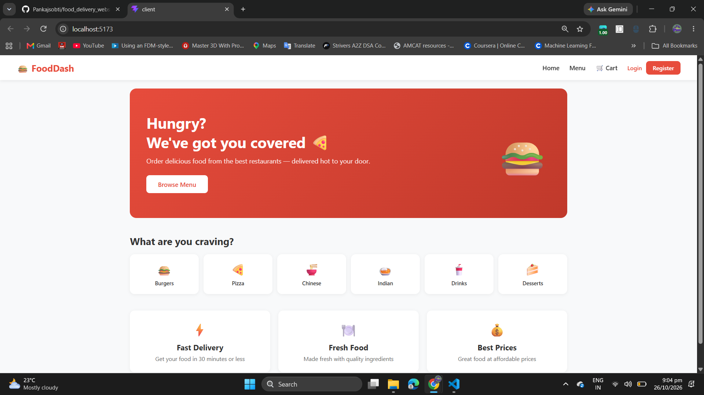
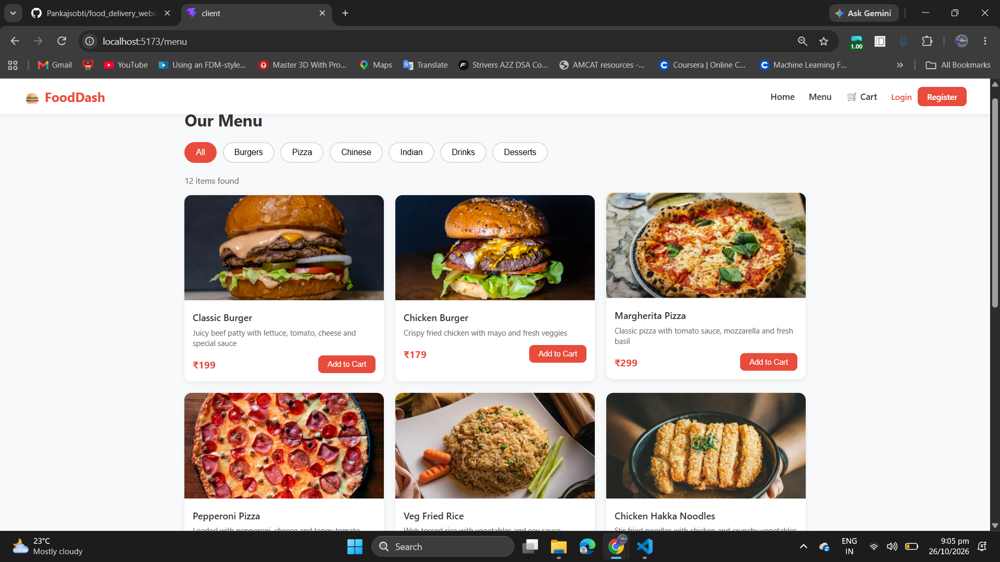
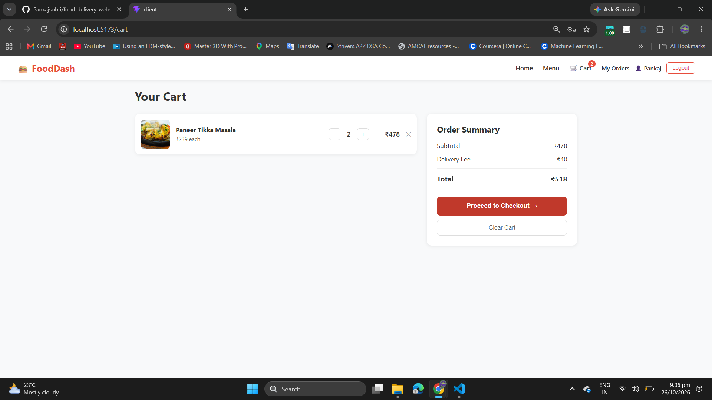
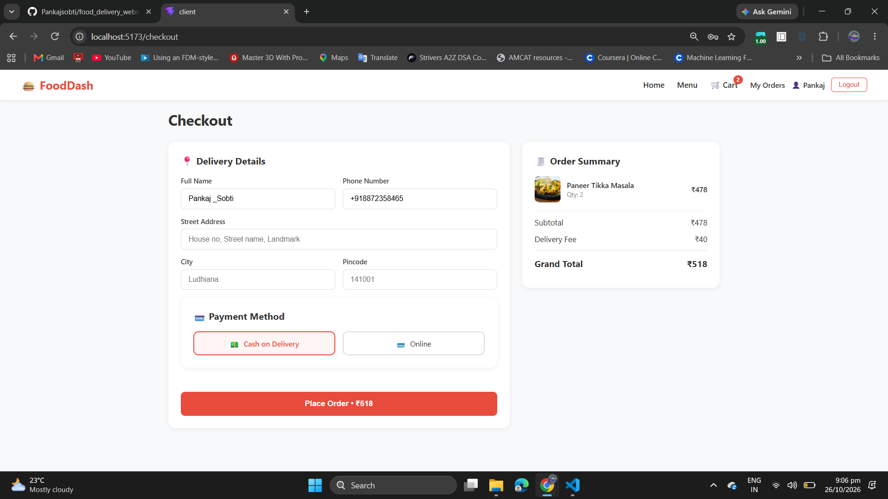
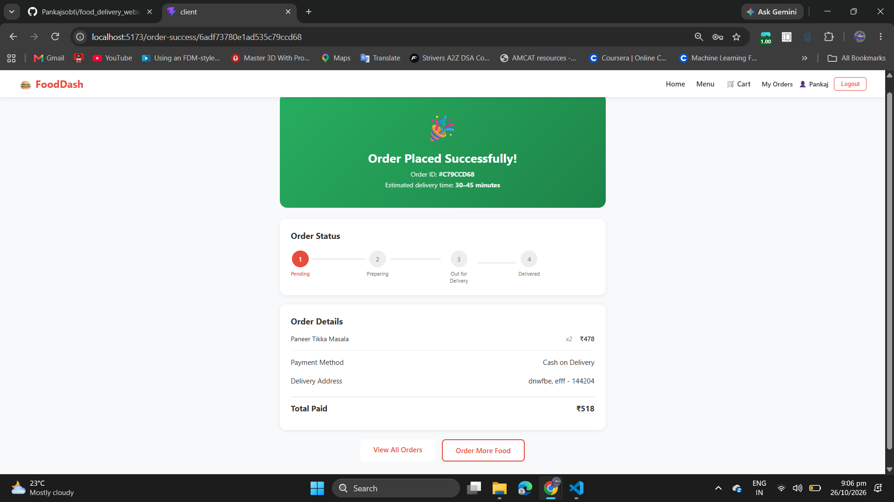

# 🍔 FoodDash — MERN Stack Food Delivery App

FoodDash is a full-stack food delivery web application built using the MERN stack (MongoDB, Express.js, React.js, and Node.js). It provides a simple and user-friendly experience for browsing food items, managing a shopping cart, placing orders, and viewing order details.

## ✨ Features

- 🏠 **Home Page:** Promotional banner, food categories, and highlights.
- 🍕 **Food Menu:** Browse food items with images, descriptions, and prices.
- 🔍 **Category Filtering:** Filter food items by category.
- 🛒 **Shopping Cart:** Add items, update quantities, remove items, and clear the cart.
- 💳 **Checkout:** Enter delivery details and select a payment method.
- 📦 **Order Management:** View order confirmation and order status.
- 👤 **User Authentication:** Login, registration, and account navigation.
- 💰 **Order Summary:** Automatic subtotal, delivery fee, and total calculation.

## 🛠️ Tech Stack

| Technology | Purpose |
|---|---|
| MongoDB | Database |
| Express.js | Backend framework |
| React.js | Frontend UI |
| Node.js | Backend runtime |
| JavaScript | Application logic |
| HTML & CSS | Structure and styling |

## 📸 Screenshots

### 🏠 Home Page


### 🍕 Menu Page


### 🛒 Shopping Cart


### 💳 Checkout Page


### ✅ Order Confirmation


> **Note:** Create a `screenshots` folder in your project root and save your screenshots using the filenames shown above.

## 🚀 Installation and Setup

### Prerequisites

- Node.js and npm
- MongoDB or MongoDB Atlas
- Git

### 1. Clone the Repository

```bash
git clone https://github.com/Pankajsobti/food_delivery_webs.git
cd food_delivery_webs
```

### 2. Install Frontend Dependencies

```bash
cd client
npm install
```

### 3. Install Backend Dependencies

Open another terminal and navigate to your backend folder.

For example, if it is named `server`:

```bash
cd server
npm install
```

### 4. Configure Environment Variables

Create a `.env` file in the appropriate directory and configure the variables required by your application.

Example:

```env
PORT=5000
MONGO_URI=your_mongodb_connection_string
JWT_SECRET=your_jwt_secret
```

Use the exact variable names expected by your code. Never upload real credentials or secrets to GitHub.

### 5. Run the Application

Start the backend using the script defined in its `package.json`. For example:

```bash
npm run dev
```

Start the frontend in a separate terminal:

```bash
cd client
npm run dev
```

Open the local URL displayed in the frontend terminal. For Vite, this is commonly `http://localhost:5173`.

> Adjust commands and folder names according to your actual project structure and `package.json` scripts.

## 📁 Project Structure

Example structure:

```text
food_delivery_webs/
├── client/          # React frontend
├── server/          # Node.js and Express backend
├── screenshots/     # Project screenshots
├── .gitignore
└── README.md
```

## 🔄 Application Workflow

1. Visit the home page.
2. Browse the menu and select food items.
3. Add items to the shopping cart.
4. Update quantities and review the total.
5. Enter delivery details and select a payment method.
6. Place the order and view the confirmation page.

## 🔐 Security

- Keep `.env` files out of version control.
- Never expose database passwords, API keys, or JWT secrets.
- Add `node_modules/` and generated build folders to `.gitignore`.

## 🚀 Future Improvements

- Online payment gateway integration.
- Real-time order tracking.
- Admin dashboard for managing menu items and orders.
- Enhanced order history.
- Improved form validation and error handling.
- Further mobile responsiveness improvements.

## 👨‍💻 Author

**Pankaj Sobti**

GitHub: [Pankajsobti](https://github.com/Pankajsobti)

---

⭐ If you like this project, consider giving the repository a star!